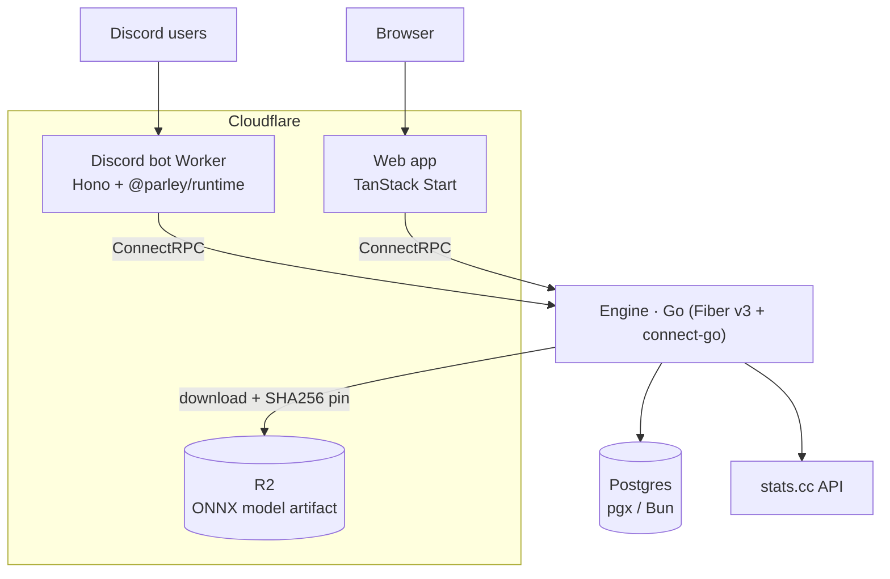

# Parley

Competitive matchmaking, tournaments, and stats for Discord communities,
built around Rainbow Six Siege.

> **Unmaintained source archive.** Parley was a working product; development has
> stopped and this repository is preserved here as a historical source archive.
> Issues are not triaged, no support is offered, and the code is provided as-is —
> see [LICENSE](./LICENSE).

## What it did

Parley linked Discord identities to in-game accounts, pulled ranked-season
telemetry from [stats.cc](https://stats.cc), scored each player with a small
learned model (OVI) plus a persistent Glicko-2 rating, and used the result to
build balanced teams, run custom matches, and operate single-elimination
tournaments — from slash commands and a web dashboard. The Go engine owns all
domain state and the only database connection; every edge app is stateless and
speaks the same protobuf contract.

## Architecture



`proto/` is the single source of truth for the wire format: `buf generate` emits
the Go types/Connect handlers in `gen/parley` and the TypeScript messages in
`packages/generated-ts`, both committed.

## Repository map

| Path                                          | What it is                                                                    |
| --------------------------------------------- | ----------------------------------------------------------------------------- |
| `cmd/parley/`, `internal/`                    | Engine: identity, stats, matchmaking, tournaments, repos                      |
| `proto/`, `gen/parley/`                       | Protobuf definitions and generated Go                                         |
| `packages/generated-ts/`, `packages/runtime/` | Generated TS messages; Discord interaction runtime and Components v2 builders |
| `apps/worker/`, `apps/docs/`                  | Discord bot Worker; docs redirect Worker                                      |
| `apps/web/`                                   | TanStack Start site: landing page, docs, profiles, dashboard                  |
| `migrations/`                                 | Postgres migrations, embedded into the engine binary                          |

## Building from source

Prerequisites: Go 1.25+, [Bun](https://bun.sh), PostgreSQL, and the
[buf CLI](https://buf.build/docs/cli/) (`buf generate` uses remote plugins, so it
needs network access). Docker is only needed for `-tags=integration` tests.

```bash
bun install
cp .env.example .env        # fill in the values below
make build                  # or: make proto && make build
```

Tests: `make test` (Go unit), `make test-integration` (Docker), `bun run test`,
`bun run typecheck`, `bun run lint`.

The engine is **not** a clone-and-run service. It exits at startup unless you supply:

- `DATABASE_URL` — Postgres (`RUN_MIGRATIONS=1` applies migrations at boot).
- `ENGINE_SHARED_SECRET` — shared secret every edge caller must present.
- `MATCHMAKING_MODEL_R2_SHA256` plus `MATCHMAKING_MODEL_R2_ACCOUNT_ID`,
  `..._ACCESS_KEY_ID`, `..._SECRET_ACCESS_KEY`, bucket and key — the SHA-256 pin
  and credentials for the R2 bucket holding the model.

The model is a narrow ONNX `LinearRegressor` graph fetched from R2; the engine
validates its structure, hashes it, and refuses to boot on a mismatch.
**Neither the model artifact nor any training code is in this repository** — you
would have to produce a conforming artifact yourself. Live player stats also need
a `STATS_CC_API_KEY`. Edge apps read secrets from Wrangler (`.dev.vars` locally);
the committed `wrangler.jsonc` files are sanitized samples with placeholder IDs,
so deploying them requires your own Cloudflare account, VPC service, Pipelines
stream, and Discord/Turnstile credentials. Cloud provisioning is not included.

## License

[MIT](./LICENSE) © 2026 Bake Computers.

MIT covers the source in this repository only. It grants no rights to the Parley
name or marks; third-party trademarks (Rainbow Six Siege / Ubisoft, Discord)
remain with their owners. The `terms`, `privacy`, and `legal-notice` pages in
`apps/web` are historical text about the former hosted service; those
hosted-service terms do not govern reuse of the MIT source here.
