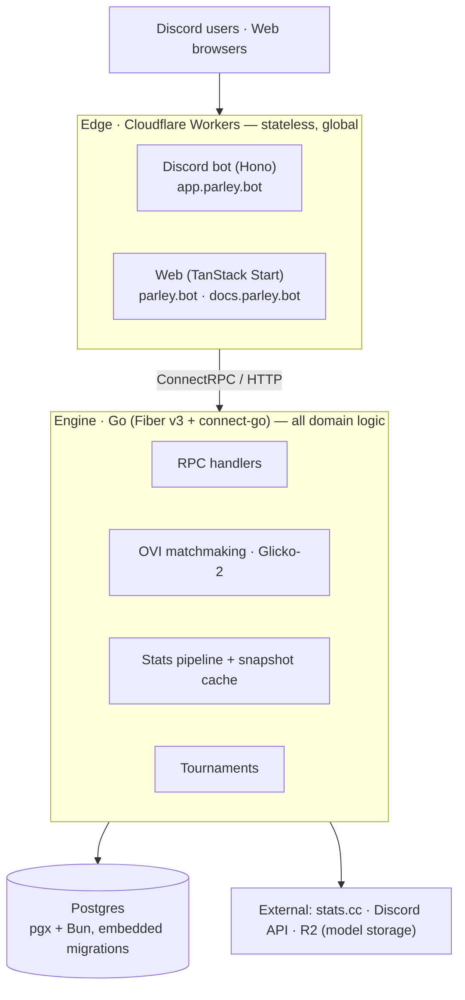

# Parley

**A technical overview of Parley's competitive matchmaking system.**
Parley Systems · 2026

Parley runs competitive matchmaking and tournaments for Discord communities.
It links Discord identities to in-game accounts, ingests ranked-season
telemetry, scores every player with a learned model, and assembles balanced
lobbies from the result. A Go engine owns the domain and the database;
stateless TypeScript applications on Cloudflare Workers provide the Discord
bot and the web surface; a shared protobuf contract sits between them.

This document describes the system as it is built today, with emphasis on
OVI, the matchmaking model at its center.

## Abstract

Community-run competitive play is degraded less by a lack of features than by
a lack of measurement. Lobbies are balanced by reputation, rankings freeze
between seasons, and tournament administration lives outside the tools
players already use. Parley treats matchmaking as a measurement problem: link
identities authoritatively, fetch current-season telemetry from upstream
providers, reduce each player to six playstyle signals, and score them with a
model small enough to be audited by hand. That model — OVI — is a single
linear regressor served from object storage. Its entire serving stack is a
strict validator and a dot product. On top of these scores, an exhaustive
role-aware partitioner builds teams, and a Glicko-2 layer carries persistent
ratings forward across matches. The surrounding platform (identity, stats
pipeline, tournaments, Discord and web edges) exists to keep those numbers
honest and to put them in front of players where they already are.

## 1. Introduction

A Discord community that plays competitively eventually builds the same
machinery by hand: a spreadsheet of ranks, an admin who knows everyone's
skill, a bracket drawn in a chat message. Each of these degrades in the same
way. The spreadsheet goes stale the day a new season starts. The admin's
estimates lag real form by weeks. The bracket is someone's unpaid labor.

Tracker sites do not fix this. They report statistics; they do not act on
them. A player's K/D is visible everywhere, and yet the lobby they get placed
into tonight is still decided by who happened to react to a message first.

Parley's position is that the missing piece is not display but modeling. The
data exists upstream. What is missing is a system that fetches it on
authority — the player *is* this account, verified by a link — reduces it to
an honest estimate of current ability, and spends that estimate on the
matchmaking and tournament decisions a community otherwise does by feel.

Three consequences follow from that position, and they shape everything else
in this document:

1. **Telemetry quality is the product.** A score computed from stale or
   partial data is worse than no score, because it is trusted. Parley refuses
   to rank players whose telemetry fails validation rather than guessing.
2. **The model must be legible.** A matchmaking model decides who plays with
   whom; players deserve a system its operators can fully explain. We
   therefore ship the smallest model that does the job, and no larger.
3. **The engine owns the truth.** Edge applications are disposable and
   stateless. Every authoritative fact — links, ratings, match records,
   brackets — lives in one Postgres database behind one Go service.

## 2. OVI: the matchmaking model

OVI is the system's estimate of a player's current contribution to a team,
derived from current-season play. It is the input to team selection and the
single most important number in the platform. This section describes what it
is, how it is fed, and why its implementation is as small as it is.

### 2.1 A model is seven numbers

An OVI model is six coefficients and an intercept. Scoring a player is a dot
product plus an addition. There is no feature store at inference time, no
graph executor, no accelerator, no model server process. The engine holds the
seven `float64`s in memory and evaluates them in a loop that a reader can
verify in ten seconds.

This is the central bet of the system, and it is a deliberate one: for the
question Parley asks — *relative to this lobby pool, how strong is this
player right now* — a linear function over well-chosen signals is sufficient,
and every parameter of complexity beyond linearity is a parameter of
opacity. Seven numbers can be printed in a log, diffed between releases, and
argued with. A gradient-boosted forest cannot. When the data eventually
demands more expressiveness, the contract below is designed so that the model
grows without the serving path changing; until then, we take the legibility.

### 2.2 The narrow ONNX contract

Models are exchanged in ONNX so that training stays a completely separate
concern from serving — any toolchain that can emit ONNX can produce a Parley
model. But Parley does not embed an ONNX runtime. Instead it accepts exactly
one shape of graph and rejects everything else at load time:

- precisely one node, op `LinearRegressor` in domain `ai.onnx.ml`, with
  `post_transform = NONE`;
- one input tensor named `playstyle_features`, rank 2, final dimension 6;
- one output tensor named `variable`, final dimension 1;
- exactly six finite coefficients and one finite intercept.

The parser is hand-rolled against the protobuf wire format — a few hundred
lines with no third-party dependency — and it fails closed. A graph with an
extra node, a renamed tensor, or a non-finite weight does not load, and the
engine does not boot with a model it cannot fully validate. The blob is
capped at 1 MiB (a conforming model measures in the low hundreds of bytes),
and its SHA-256 is logged at startup alongside the storage ETag, so the exact
model serving in production is a matter of record.

The result is that "ML infrastructure" collapses into an object download and
a validator. There is nothing to page on, nothing to scale, and nothing
between the model and the arithmetic that uses it.

### 2.3 Six playstyle signals

The model's quality lives in its features, and Parley takes some care here.
Each player's current snapshot is reduced to six signals:

| # | Signal      | Construction                                                                 |
| - | ----------- | ---------------------------------------------------------------------------- |
| 1 | Fragging    | K/D, blended between the season aggregate and a round-level rollup           |
| 2 | Entry       | opening-kill rounds ÷ (opening-kill + opening-death rounds)                  |
| 3 | Trading     | traded rounds ÷ deaths                                                       |
| 4 | Clutching   | (1v1 + 2·1v2 + 3·1v3 wins) ÷ rounds played                                   |
| 5 | Execution   | headshot percentage, blended with headshot-only rounds per round             |
| 6 | Winning     | win rate                                                                     |

Two notes on construction. First, signals 1 and 5 are *blended*: for players
with few current-season matches the round-level rollup dominates, and the
season aggregate takes over as matches accrue (fully weighted at 20 games).
This keeps a player who has played three matches this season from being
defined by them. Second, every input is derived from telemetry that must be
present and finite — if any underlying counter is missing from the snapshot
metadata, Parley declines to score the player at all. Earlier versions of
this pipeline scored missing data as zero and silently mis-ranked players as
a result; the current design fails loudly instead.

Features 2–5 double as a role profile: normalized, they describe whether a
player's contribution comes from entrying, trading, clutching, or executing.
The model scores strength; the same signals, read sideways, describe shape.

### 2.4 Role-aware team partitioning

Team selection minimizes, over every valid split of the lobby,

    |strength(A) − strength(B)| + α·roleΔ + β·roleCollision

where team strength is the sum of its players' clamped model scores, `roleΔ`
is the divergence of the two teams' aggregate role profiles, and
`roleCollision` penalizes stacking redundant roles onto one side. `α` and `β`
are per-guild configuration, so a community can decide for itself how much it
cares about composition versus raw balance. The search is exhaustive over
combinations and ties break lexicographically — balance first, then roles —
so the partition returned is a genuine optimum of the stated objective, not a
heuristic approximation of one.

Ratings ride alongside: every player carries a persistent Glicko-2 rating
(μ, φ), and match results update it with an outcome modulated by how the
player's score compared to the lobby's expected level. OVI decides tonight's
teams; Glicko-2 remembers how tonight went.

### 2.5 Deployment is an object upload

A new model is trained offline, exported to the narrow ONNX contract, and
uploaded to an R2 bucket. The engine fetches it at startup by its bucket and
key, validates it, hashes it, and serves. There is no model registry, no
canary deployment machinery, no version skew: the configuration names a key,
the key names a model, and the startup log names its hash. Rolling forward
and rolling back are the same operation — put an object, restart the
process — which is as much model-deployment ceremony as seven numbers
warrant.

### 2.6 What we did not build

For the record: no embedding service, no feature store, no online training,
no GPU path, no model-version table. Each was considered and each would have
answered a question the system does not have. The day a second game or a
non-linear model arrives, the narrow contract is the seam: widen the feature
dimension or the accepted op set, and nothing downstream of `Score` changes.

## 3. System architecture

Parley divides into four tiers. Only the engine touches the database; only
`proto/` defines the wire.



**The contract.** Every RPC and message is defined in `proto/` and generated
by `buf` into both Go (`gen/parley`) and TypeScript
(`packages/generated-ts`). The engine and the edges never share a struct;
they share a schema, and it is wire-compatible or it does not merge.

**A request, end to end.** Discord posts a signed interaction to the Worker;
the Worker verifies the Ed25519 signature and dispatches to a command
handler; the handler calls the engine over ConnectRPC (`/link` →
`IdentityService`, team build → `MatchmakingService`); the engine validates,
reads and writes through its repositories, returns a typed response; the
Worker renders it as an embed via `@parley/runtime`. The edge holds nothing
between requests.

**The stats pipeline.** Player statistics flow from stats.cc through an
in-process snapshot cache into domain types, and are persisted to Postgres
asynchronously. Reads are served from the cache; history accumulates in the
database. The snapshot metadata carries the round-level counters OVI's
features are built from — the pipeline's job, ultimately, is to keep that
telemetry current enough to score.

## 4. The engine service

The `parley` binary (Fiber v3 + connect-go) exposes six services:

| Service                | Responsibility                                              |
| ---------------------- | ----------------------------------------------------------- |
| `IdentityService`      | Link, unlink, and resolve Discord-to-player mappings        |
| `StatsService`         | Single-season and full-collection player statistics         |
| `GuildSettingsService` | Per-guild settings, matchmaking rules, quotas               |
| `UserSettingsService`  | Per-user preferences within a guild                         |
| `MatchmakingService`   | OVI team building, custom matches, result reporting         |
| `TournamentService`    | Creation, registration, single-elimination bracket play     |

Custom matches and tournaments share one match-record model, so a ranked
night and a bracket run through the same lifecycle. Eligibility — link
required, guild rank gates, quotas, per-user opt-out, minimum current-season
matches — is enforced before a player is ever scored.

Postgres is the system of record for identities, snapshots, matches,
tournaments, and configuration. All domain tables are scoped by a `games`
enum (`r6` today) with composite uniqueness including the game, so adding a
title is a migration, not a rewrite. Domain timestamps are `bigint` epoch
milliseconds. The engine fails fast at boot without `DATABASE_URL`, and
migrations are embedded and applied in-process when `RUN_MIGRATIONS=1`.

## 5. Operations

| Component        | Runtime                    | Domain           |
| ---------------- | -------------------------- | ---------------- |
| Discord Worker   | Cloudflare Worker (Hono)   | `app.parley.bot` |
| Web              | TanStack Start, Cloudflare | `parley.bot`     |
| Docs             | Static (Astro), Cloudflare | `docs.parley.bot`|
| Engine           | Container image, `ghcr.io` | origin, `:50051` |

Workers deploy via Wrangler (per-app `wrangler.jsonc`, secrets via
`wrangler secret put`). The engine image is built by CI from `main` on engine
path changes and pushed to GHCR; runtime rollout is outside CI. When
`AXIOM_TOKEN` is set, engine and edges emit structured logs to a shared Axiom
dataset.

## 6. Development

```bash
bun install                 # workspace dependencies
cp .env.example .env        # DATABASE_URL required to boot the engine
make proto && make build    # regenerate clients, build the engine
RUN_MIGRATIONS=1 make run   # boot with boot-time migrations
bun run dev                 # edge dev servers
```

| Task                    | Command                                |
| ----------------------- | -------------------------------------- |
| Go unit tests           | `make test`                            |
| Go integration tests    | `make test-integration` (Docker)       |
| TypeScript typecheck    | `bun run typecheck`                    |
| Lint (Go / TS)          | `make lint` / `bun run lint`           |
| Format (Go / TS)        | `make fmt` / `bun run format`          |
| Regenerate protobuf     | `make proto`                           |

Contributor conventions — code style, testing expectations, migration rules,
PR checklist — live in [`AGENTS.md`](AGENTS.md). Protocol notes live in
`proto/` comments; user-facing docs live in `apps/docs`.

## Appendix A. Repository layout

```
proto/                  Protobuf definitions — the wire contract
cmd/parley/             Engine entrypoint
internal/               Domain logic: matchmaking (OVI, Glicko-2), stats,
                        services, repos, tournament brackets
gen/parley/             buf-generated Go (do not edit)
migrations/             Postgres SQL migrations
apps/worker/            Discord bot Worker
apps/web/               TanStack Start web app
apps/docs/              User documentation
packages/generated-ts/  @parley/proto — generated TS clients
packages/runtime/       @parley/runtime — Discord embeds & components v2
```

## License

Parley is proprietary software licensed under the **Parley Proprietary License** (see [`LICENSE`](./LICENSE)).

- **Allowed:** private, personal, non-commercial use on systems you control.
- **Prohibited:** commercial / for-profit use, modification, redistribution, hosting for others, and competing products built from the Software.

Commercial licensing: `hi@ryzm.cc`.
