# Parley

## Abstract

Parley is a competitive matchmaking and tournament platform for Discord communities. It links Discord identities to in-game player profiles, ingests performance telemetry from external stat providers, and uses a skill-rating engine to assemble balanced teams, run ranked queues, and operate bracket tournaments. The system is implemented as a polyglot monorepo: a Rust engine-service owns domain logic and persistence, while TypeScript applications on Cloudflare Workers provide the Discord bot, public web presence, and real-time leaderboard delivery. A shared Protocol Buffers contract defines the service boundary between the edge and the engine, enabling independent deployment, strict typing, and consistent evolution across languages.

---

## 1. Problem Statement

Competitive gaming communities on Discord face a recurring set of operational failures:

- **Manual team balancing** relies on subjective rank estimates and produces lopsided lobbies.
- **Identity fragmentation** separates Discord users from their actual in-game accounts across platforms.
- **Tournament administration** demands bracket management, roster tracking, and result reporting outside the tools players already use.
- **Stale performance data** decouples matchmaking from how players are actually performing in the current season.

Parley addresses these failures by centralizing identity resolution, telemetry ingestion, skill modeling, and match lifecycle management behind a single engine, exposed to Discord and the web through a thin, stateless edge layer.

---

## 2. Solution Overview

Parley delivers three primary capabilities:

1. **Account linking** — A Discord user may link exactly one in-game profile per supported game (e.g., Rainbow Six Siege and Brawl Stars). Links are authoritative for all downstream matchmaking and stats lookups.

2. **Telemetry-driven matchmaking** — The engine fetches ranked-season statistics from upstream providers, normalizes them into a Composite Performance Rating (CPR), and applies Glicko-2 team-balancing heuristics to minimize expected skill gaps across both sides of a lobby.

3. **Structured competition** — Guild-scoped queues, custom matches, and single-elimination tournaments share a common match record model. Guild administrators configure matchmaking rules, notification preferences, and quotas per game.

The platform is **Discord-first**: the primary interaction surface is a Cloudflare Worker hosting the bot. A TanStack Start landing application provides marketing, legal pages, and a live global leaderboard. Both edge applications communicate with the engine exclusively through ConnectRPC over HTTP.

---

## 3. Architectural Principles

| Principle | Rationale |
| --- | --- |
| **Single source of truth for contracts** | All RPC messages and service definitions live in `proto/`. Rust embeds them via `protox`; TypeScript generates clients via `buf`. |
| **Engine owns state** | Postgres is the system of record. Redis accelerates stats caching and leaderboard reads when present. Edge workers remain stateless except for the leaderboard Durable Object. |
| **Game-scoped multi-tenancy** | Every domain table carries a `game` discriminator (`r6`, `brawl_stars`). Composite unique indexes always include `game`, allowing one schema to serve multiple titles. |
| **Graceful degradation** | Without `DATABASE_URL`, the engine runs in memory-only mode. Without `REDIS_URL`, caching falls back to direct backend calls. The service remains operable for development and partial outages. |
| **Edge locality** | Discord interactions and web traffic terminate at Cloudflare Workers globally. Only RPC calls to the engine cross into the origin network. |

---

## 4. System Topology

Parley divides into four logical tiers:

```
┌─────────────────────────────────────────────────────────────────┐
│  Clients                                                        │
│  Discord users · Web browsers                                   │
└────────────────────────────┬────────────────────────────────────┘
                             │
┌────────────────────────────▼────────────────────────────────────┐
│  Edge (Cloudflare Workers)                                    │
│  Discord Worker · Landing App · Leaderboard Bridge Worker     │
└────────────────────────────┬────────────────────────────────────┘
                             │ ConnectRPC / HTTP
┌────────────────────────────▼────────────────────────────────────┐
│  Engine (Rust / Axum)                                         │
│  ConnectRPC handlers · Matchmaking engine · Stats backends    │
└────────────┬───────────────────────────────┬────────────────────┘
             │                               │
┌────────────▼──────────┐       ┌────────────▼──────────────────┐
│  Postgres             │       │  Redis (optional)             │
│  Diesel-async + bb8   │       │  Stats cache · Leaderboard    │
└───────────────────────┘       └───────────────────────────────┘
             │
┌────────────▼──────────────────────────────────────────────────┐
│  External providers                                           │
│  stats.cc · Brawl Stars API · Discord API                     │
└───────────────────────────────────────────────────────────────┘
```

---

## 5. Component Reference

### 5.1 Protocol Contract (`proto/`)

Protobuf definitions are the canonical API surface. Seven services are defined:

| Service | Responsibility |
| --- | --- |
| `IdentityService` | Link, unlink, and resolve Discord-to-player mappings |
| `StatsService` | Fetch single-season or full-season-collection player statistics |
| `GuildSettingsService` | Per-guild configuration: settings, matchmaking rules, notifications, quotas |
| `UserSettingsService` | Per-user preferences within a guild context |
| `MatchmakingService` | Team building, queue lifecycle, custom matches, result reporting |
| `TournamentService` | Tournament creation, registration, bracket progression |
| `LeaderboardService` | Guild and global leaderboard queries |

Shared types (`Game`, `Rank`, `PlayerStats`, `Badge`, `Region`, `Language`) reside in `common/v1/types.proto`.

### 5.2 Engine Service (`src/`)

The `parley` binary is an Axum HTTP server exposing ConnectRPC endpoints. Internal modules include:

- **Handlers** — One module per protobuf service; deserialize Connect envelopes, invoke repositories, serialize responses.
- **Matchmaking engine** — Pure-logic CPR and Glicko-2 team balancer with queue management and a background sweeper for stale entries.
- **Tournament engine** — Bracket generation, seeding, and progression logic.
- **Stats pipeline** — `StatsBackendRegistry` dispatches per-game backends; `R6Backend` scrapes stats.cc HTML via a Nuxt payload parser. Results pass through a tiered cache (`RedisStatsCacheStore` or `DirectStatsCacheStore`) with optional Postgres persistence.
- **Database layer** — Diesel-async schema, connection pool, and repository modules for players, identities, matches, tournaments, and guild configuration.

### 5.3 Edge Applications

| Application | Runtime | Role |
| --- | --- | --- |
| `apps/worker` | Cloudflare Worker (Hono) | Discord bot: slash commands, interaction verification, embed rendering |
| `apps/landing` | TanStack Start on Cloudflare | Public website, leaderboard UI, legal pages |
| `apps/bridge` | Cloudflare Worker (Hono) | Leaderboard aggregation; hosts `GlobalLeaderboard` Durable Object |

The Discord Worker uses `@parley/runtime` — a type-safe wrapper over Discord's API for Embeds and Components v2 — and `@parley/proto` ConnectRPC clients to call the engine.

The Bridge Worker polls `LeaderboardService` on a configurable interval, stores snapshots in SQLite-backed Durable Object storage, and fans out updates over WebSocket to connected landing-page clients.

### 5.4 Shared TypeScript Packages

| Package | Purpose |
| --- | --- |
| `@parley/proto` | Buf-generated message types and Connect service descriptors |
| `@parley/runtime` | Discord interaction framework, embed builders, component builders |
| `@parley/axiom` | Structured logging middleware shared across Workers |
| `@parley/tsconfig-base` | Strict TypeScript compiler defaults for all workspaces |
| `@parley/db` | Legacy Drizzle schema (frozen; not extended) |

### 5.5 Data Stores

**Postgres** holds all durable domain state: players, discord identities, guild memberships, match and queue records, tournament brackets, stat snapshots, and configuration rows. Migrations live in `/migrations`; the hand-maintained Diesel bindings in `src/db/schema.rs` are authoritative.

**Redis** (optional) backs the stats cache and in-memory leaderboard store. When absent, the engine serves stats directly from upstream backends with Postgres write-through persistence.

**Durable Object SQLite** stores the latest leaderboard snapshot per metric inside the Bridge Worker, enabling low-latency WebSocket broadcast without hitting the engine on every page view.

---

## 6. Matchmaking Engine

The matchmaking subsystem is implemented as pure Rust with no I/O dependencies, making it fully unit-testable.

1. **Eligibility** — Players must be linked, meet guild-configured rank gates, and satisfy quota limits before entering a queue.
2. **Signal extraction** — Raw stats (K/D, win rate, KPR, KOST, headshot percentage, survival rate, MMR) are z-score normalized against population samples drawn from the guild roster.
3. **CPR computation** — Normalized signals combine into a Composite Performance Rating used for team assignment and win-probability estimation.
4. **Glicko-2 balancing** — Team permutations are evaluated to minimize the balance gap and expected lobby CPR while respecting team-size constraints.
5. **Queue lifecycle** — Captains submit stacks; the sweeper retires expired entries. On match, team assignments and balance metadata are persisted and returned to the caller.

---

## 7. Request Lifecycle

A typical Discord slash command (e.g., `/link`) follows this path:

1. Discord delivers an interaction payload to the Worker.
2. The Worker verifies the Ed25519 signature, dispatches to the registered command handler.
3. The handler constructs a ConnectRPC request and POSTs it to the engine's `IdentityService`.
4. The engine handler validates input, writes to Postgres via Diesel repositories, and returns a typed response.
5. The Worker renders the result as a Discord embed via `@parley/runtime` builders and responds to the interaction.

Leaderboard page loads follow a parallel path through the Landing App to the Bridge Worker, which serves cached snapshots or live WebSocket streams without routing through the Discord Worker.

---

## 8. Deployment

Infrastructure is provisioned through **Alchemy** (`alchemy.run.ts`), which deploys three Cloudflare Workers:

| Worker | Domain |
| --- | --- |
| Discord Worker | `app.parley.bot` |
| Landing App | `parley.bot` |
| Bridge Worker | `bridge.parley.bot` |

The engine-service runs as a standalone process (default listen address `0.0.0.0:50051`) on origin infrastructure with `DATABASE_URL` and optionally `REDIS_URL`. Workers receive `ENGINE_SERVICE_URL` as a binding.

Observability is unified through Axiom: engine-service, Worker, and Bridge all emit structured logs to a shared dataset when `AXIOM_TOKEN` is configured.

---

## 9. Architecture Diagram

The diagram below represents Parley at the service and subsystem level. Individual HTTP paths and RPC method names are omitted; arrows denote dependency and data flow between components.

```mermaid
flowchart TB
    subgraph clients["Client Layer"]
        discord_users["Discord Users"]
        web_users["Web Browsers"]
    end

    subgraph discord_platform["Discord Platform"]
        discord_api["Discord API"]
    end

    subgraph edge["Edge Layer — Cloudflare Workers"]
        subgraph discord_worker["Discord Worker"]
            hono_worker["Hono HTTP Server"]
            parley_client["ParleyClient"]
            slash_handlers["Slash Command Handlers"]
            embed_renderer["Embed and Component Renderer"]
        end

        subgraph landing_app["Landing Application"]
            tanstack_start["TanStack Start SSR"]
            leaderboard_ui["Leaderboard UI"]
            bridge_proxy["Bridge Service Binding"]
        end

        subgraph bridge_worker["Leaderboard Bridge Worker"]
            bridge_hono["Hono HTTP Server"]
            global_lb_do["GlobalLeaderboard Durable Object"]
            ws_fanout["WebSocket Fan-out"]
            poll_scheduler["Poll Scheduler"]
        end

        axiom_edge["Axiom Logging Middleware"]
    end

    subgraph shared_ts["Shared TypeScript Packages"]
        proto_ts["@parley/proto"]
        runtime_pkg["@parley/runtime"]
        axiom_pkg["@parley/axiom"]
    end

    subgraph engine["Engine Layer — Rust parley Binary"]
        axum_server["Axum HTTP Server"]
        connect_rpc["ConnectRPC Envelope Layer"]

        subgraph rpc_services["RPC Service Handlers"]
            identity_svc["IdentityService"]
            stats_svc["StatsService"]
            guild_svc["GuildSettingsService"]
            user_svc["UserSettingsService"]
            match_svc["MatchmakingService"]
            tournament_svc["TournamentService"]
            leaderboard_svc["LeaderboardService"]
        end

        subgraph domain_logic["Domain Subsystems"]
            matchmaking_engine["Matchmaking Engine\nCPR and Glicko-2 Balancer"]
            queue_manager["Queue Manager"]
            queue_sweeper["Queue Sweeper"]
            tournament_engine["Tournament Engine\nBracket and Seeding"]
            stats_registry["Stats Backend Registry"]
            r6_backend["R6 Stats Backend"]
            nuxt_parser["Nuxt Payload Parser"]
            guild_cache["Guild Cache"]
            stats_persister["Stats Persister"]
        end

        subgraph data_access["Data Access Layer"]
            diesel_repos["Diesel Repositories"]
            diesel_pool["Connection Pool bb8"]
        end

        axiom_engine["Axiom Logger"]
    end

    subgraph persistence["Persistence Layer"]
        postgres["PostgreSQL"]
        redis["Redis\noptional"]
        do_sqlite["Durable Object SQLite"]
    end

    subgraph external["External Providers"]
        stats_cc["stats.cc"]
        brawl_api["Brawl Stars API"]
    end

    subgraph contract["Contract Layer"]
        proto_defs["Protocol Buffers\nproto/"]
        buf_gen["Buf Code Generation"]
    end

    discord_users -->|"interactions"| discord_api
    discord_api -->|"webhook"| hono_worker
    web_users -->|"HTTPS"| tanstack_start
    web_users -->|"WebSocket"| bridge_hono

    hono_worker --> parley_client
    parley_client --> slash_handlers
    slash_handlers --> embed_renderer
    embed_renderer -->|"responses"| discord_api

    parley_client --> runtime_pkg
    parley_client --> proto_ts
    hono_worker --> axiom_edge
    bridge_hono --> axiom_edge
    axiom_edge --> axiom_pkg

    tanstack_start --> leaderboard_ui
    leaderboard_ui --> bridge_proxy
    bridge_proxy --> bridge_hono

    bridge_hono --> global_lb_do
    global_lb_do --> ws_fanout
    global_lb_do --> do_sqlite
    poll_scheduler --> global_lb_do

    parley_client -->|"ConnectRPC"| connect_rpc
    bridge_hono -->|"ConnectRPC"| connect_rpc
    poll_scheduler -->|"ConnectRPC"| connect_rpc

    axum_server --> connect_rpc
    connect_rpc --> identity_svc
    connect_rpc --> stats_svc
    connect_rpc --> guild_svc
    connect_rpc --> user_svc
    connect_rpc --> match_svc
    connect_rpc --> tournament_svc
    connect_rpc --> leaderboard_svc

    identity_svc --> diesel_repos
    guild_svc --> diesel_repos
    user_svc --> diesel_repos
    match_svc --> matchmaking_engine
    match_svc --> queue_manager
    match_svc --> diesel_repos
    tournament_svc --> tournament_engine
    tournament_svc --> diesel_repos
    leaderboard_svc --> diesel_repos
    stats_svc --> stats_registry

    matchmaking_engine --> queue_manager
    queue_manager --> queue_sweeper
    queue_sweeper --> diesel_repos
    tournament_engine --> diesel_repos

    stats_registry --> r6_backend
    r6_backend --> nuxt_parser
    r6_backend --> stats_cc
    stats_registry --> stats_persister
    stats_persister --> diesel_repos
    stats_persister --> guild_cache
    guild_cache --> redis

    diesel_repos --> diesel_pool
    diesel_pool --> postgres
    stats_registry --> redis
    leaderboard_svc --> redis

    proto_defs --> buf_gen
    buf_gen --> proto_ts
    proto_defs -->|"protox build.rs"| connect_rpc

    axum_server --> axiom_engine
```



---

## 10. Data Model Summary

The Postgres schema is organized around game-scoped entities:

- **Identity** — `players`, `discord_identities`, `guild_memberships`
- **Performance** — `player_stat_snapshots`, `external_match_history`
- **Matchmaking** — `match_queues`, `matches`, `match_participants`
- **Tournaments** — `tournaments`, `tournament_teams`, `bracket_matches`
- **Configuration** — `guild_settings`, `guild_matchmaking_rules`, `guild_notification_settings`, `guild_match_quotas`, `user_settings`

Domain timestamps use `bigint` epoch milliseconds. Auth-adjacent tables (managed by better-auth conventions) use `timestamptz`.

---

## 11. Supported Games

| Game | Proto enum | Stats source | Matchmaking |
| --- | --- | --- | --- |
| Rainbow Six Siege | `GAME_R6` | stats.cc scraper | Full CPR engine |
| Brawl Stars | `GAME_BRAWL_STARS` | Brawl Stars API | Identity linking; extended matchmaking planned |

Adding a new title requires a Postgres migration (`ALTER TYPE games ADD VALUE`), a stats backend implementation, and proto enum extension.

---

## 12. Local Development

```bash
# Install TypeScript dependencies
bun install

# Copy environment template
cp .env.example .env

# Build Rust engine (includes proto codegen)
cargo build

# Run engine-service (requires DATABASE_URL for full functionality)
cargo run

# Start all Cloudflare Workers and landing dev servers
bun run dev
```

| Command | Scope |
| --- | --- |
| `cargo test --lib` | Rust unit tests (no database) |
| `cargo test` | Full Rust test suite |
| `bun run typecheck` | TypeScript strict checking |
| `bun run lint` | Oxlint across workspaces |
| `cargo fmt && bun run format` | Format Rust and TypeScript |

Generate TypeScript proto clients after modifying `.proto` files:

```bash
cd packages/generated-ts && bun run generate
```

---

## 13. Repository Layout

```
parley/
├── proto/                  Protocol Buffer definitions (source of truth)
├── src/                    Rust engine-service
├── migrations/             Postgres SQL migrations
├── apps/
│   ├── worker/             Discord bot Worker
│   ├── landing/            TanStack Start web application
│   └── bridge/             Leaderboard Bridge Worker + Durable Object
├── packages/
│   ├── generated-ts/       @parley/proto — generated clients
│   ├── runtime/            @parley/runtime — Discord framework
│   ├── axiom/              @parley/axiom — logging middleware
│   ├── db/                 @parley/db — frozen legacy schema
│   └── tsconfig-base/      Shared TypeScript config
├── alchemy.run.ts          Cloudflare deployment orchestration
└── AGENTS.md               Contributor and agent reference
```

---

## 14. License

The engine-service is dual-licensed under MIT OR Apache-2.0. See `Cargo.toml` for details.